<p align="center">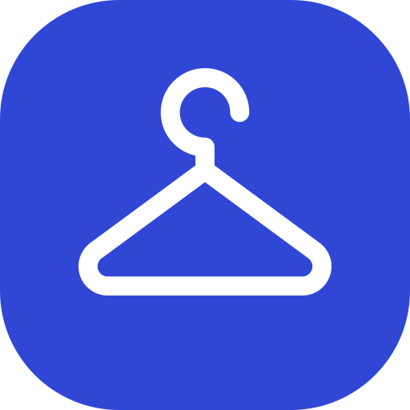</p>

<h1 align="center">CLOSET.</h1>

<p align="center"><strong>내가 가진 옷으로 코디를 만들고, 입은 날을 기록하는 개인 디지털 옷장</strong></p>
<p align="center">Expo · React Native · TypeScript · Supabase</p>

<p align="center">
  <a href="#주요-화면">주요 화면</a> ·
  <a href="#구현-포인트">구현 포인트</a> ·
  <a href="#로컬에서-실행">로컬에서 실행</a>
</p>

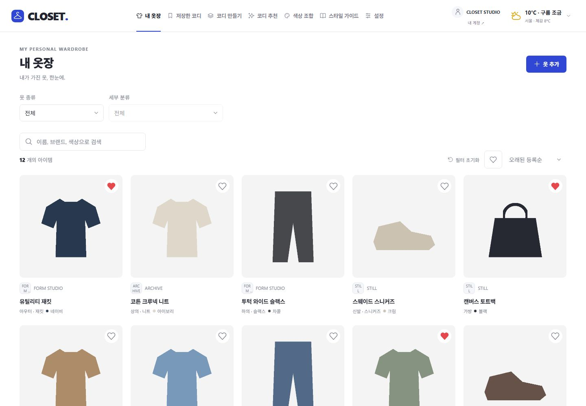

옷 사진과 구매 정보를 한곳에 모으고, 보유 의류로 조합한 코디를 저장합니다. 무엇을 입을지 고민될 때는 내 옷장 안에서 추천을 받고, 직접 입은 뒤에는 사진과 날짜를 남겨 다시 찾아볼 수 있습니다.

운영 웹은 소유자 계정으로 접속할 수 있으며, 공개 회원가입은 준비 중입니다. 아래 화면은 로컬 테스트 계정의 샘플 데이터로 캡처했습니다. [CLOSET 웹](https://closet.itsmesungjun.chatgpt.site) · [공개 가입 준비 현황](docs/PUBLIC_SIGNUP.md)

## 주요 화면

| 코디 만들기 | 저장한 코디 |
| --- | --- |
| [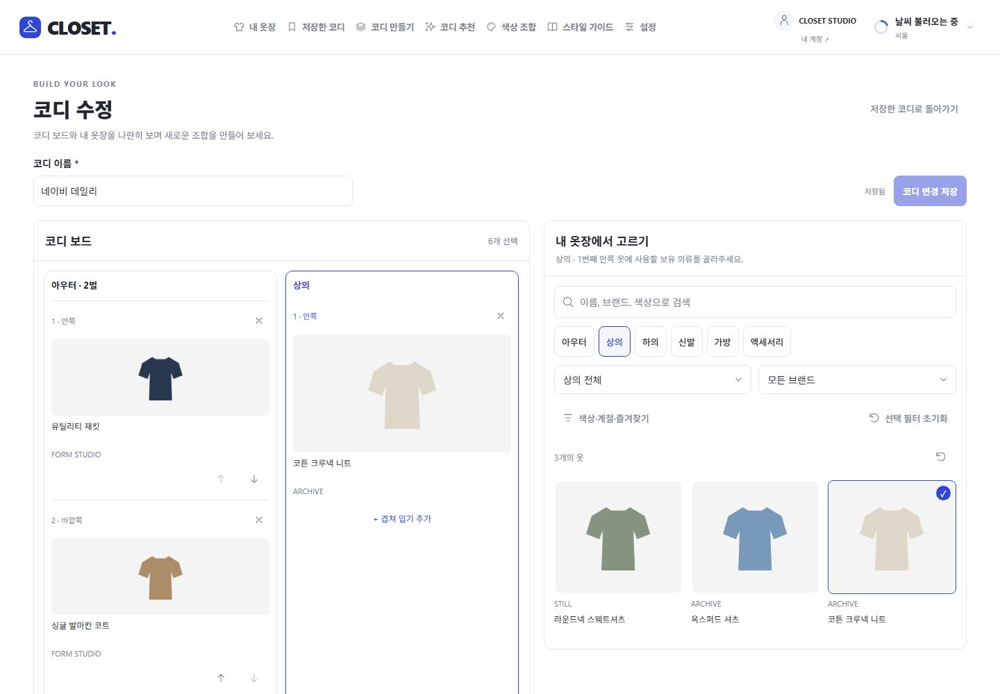](docs/portfolio/outfit-editor.jpg) | [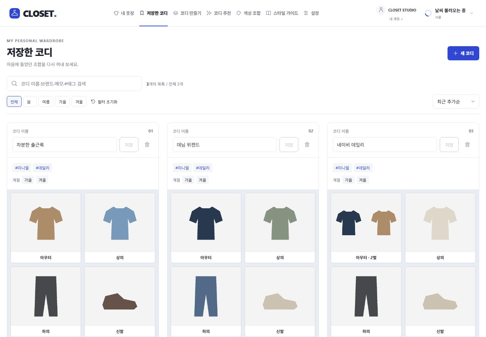](docs/portfolio/outfits.jpg) |
| 아우터와 상의를 각각 최대 3벌까지 고르고 안쪽에서 바깥쪽 순서로 배치합니다. | 이름·태그·계절로 다시 찾고, 저장한 조합을 편집하거나 복제합니다. 실제 착용 사진 한 장을 첨부하고 확대·교체·삭제할 수 있습니다. |

| 코디 추천 | 색상 조합 |
| --- | --- |
| [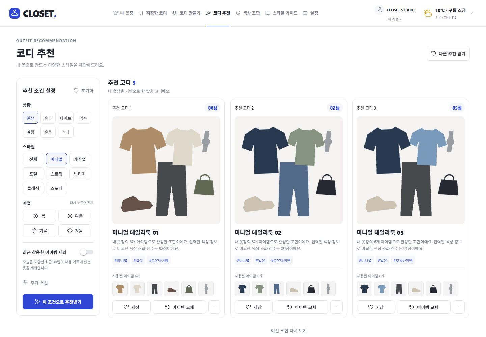](docs/portfolio/recommendations.jpg) | [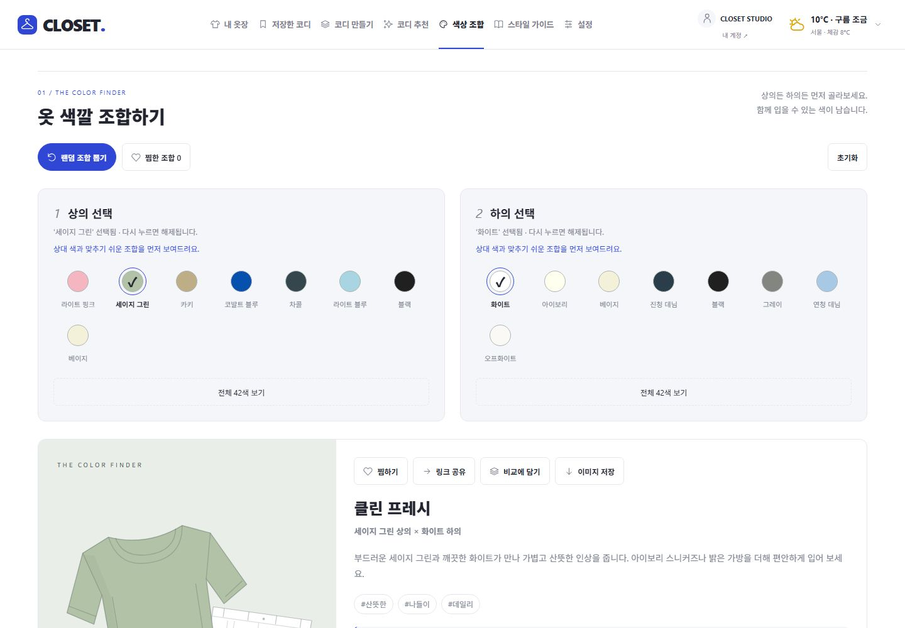](docs/portfolio/color-combinations.jpg) |
| 상황·스타일·계절에 맞춰 보유 의류를 조합하고 점수와 이유를 보여줍니다. 원하는 옷을 고정하거나 교체하고, 최근 착용한 옷을 제외할 수 있습니다. | 상의와 하의의 어울리는 색을 탐색하고, 마음에 드는 조합을 찜하거나 나란히 비교합니다. |

| 착용 달력 | 옷장 통계 |
| --- | --- |
| [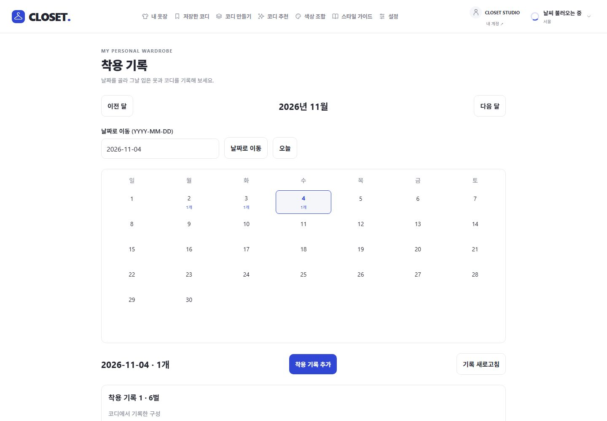](docs/portfolio/calendar.jpg) | [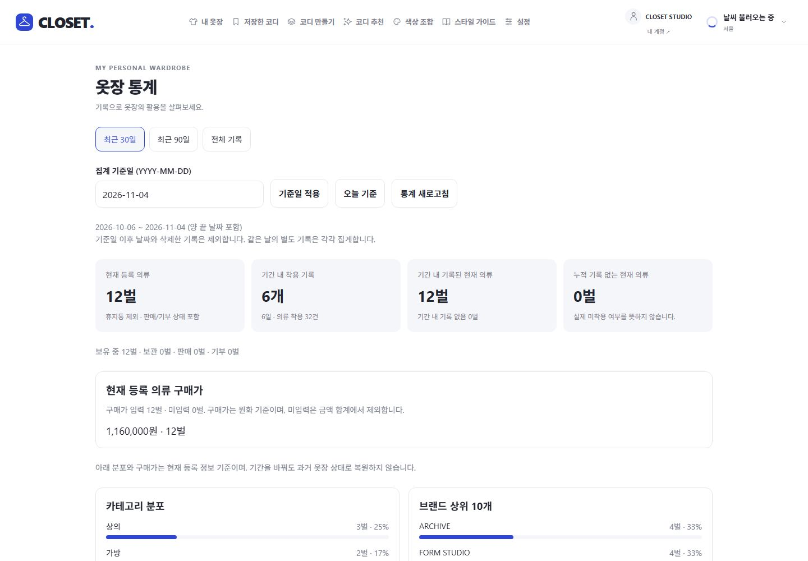](docs/portfolio/insights.jpg) |
| 날짜별로 입은 코디와 메모를 남깁니다. 당시 의류 정보는 기록에 따로 보관합니다. | 기간별 착용 빈도, 브랜드·분류별 분포, 구매가와 착용당 비용을 확인합니다. |

| 스타일 가이드 | 설정 |
| --- | --- |
| [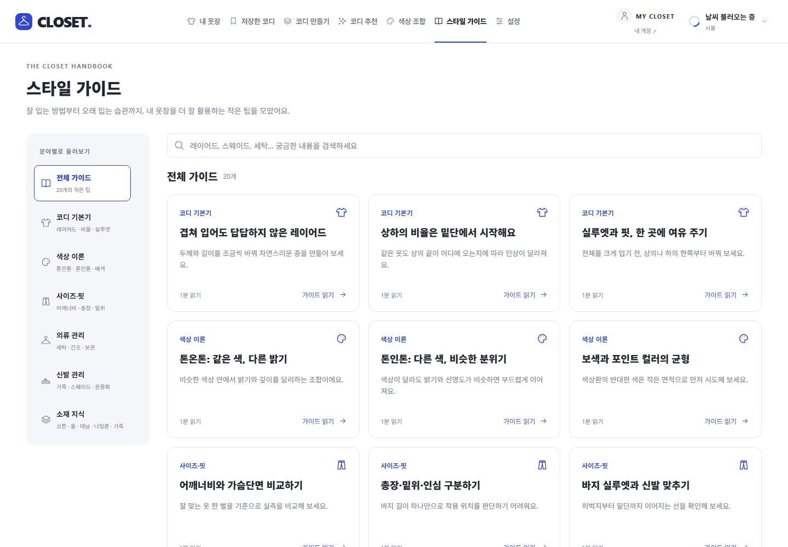](docs/portfolio/style-guide.jpg) | [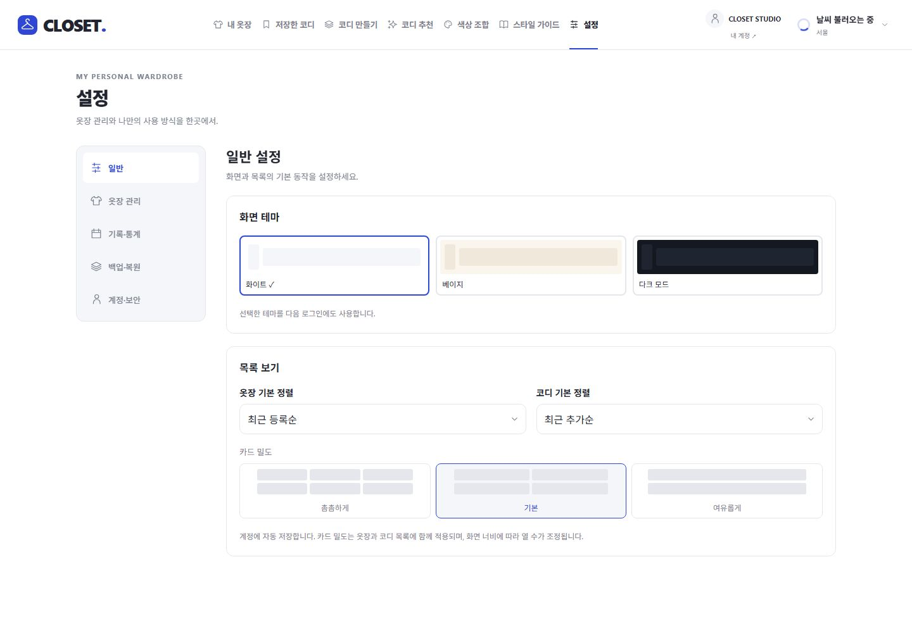](docs/portfolio/settings.jpg) |
| 코디 기본기, 색상, 핏, 소재, 의류·신발 관리 팁을 주제별로 읽을 수 있습니다. | 테마·카드 밀도·정렬을 바꾸고, 브랜드 로고와 세부 분류를 관리합니다. |

<details>
<summary><strong>모바일 웹 화면 보기</strong></summary>

| 내 옷장 | 실제 착용 사진 |
| --- | --- |
| 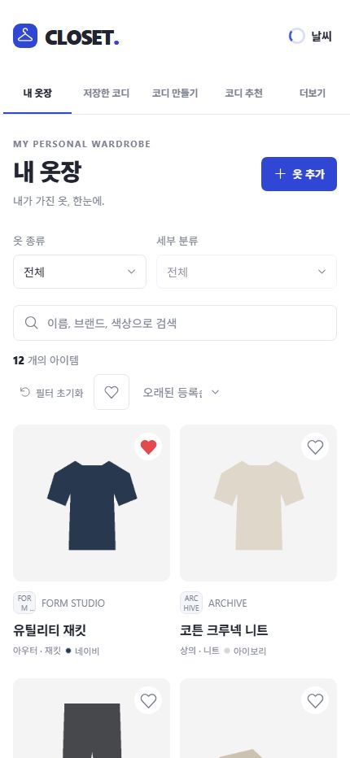 | 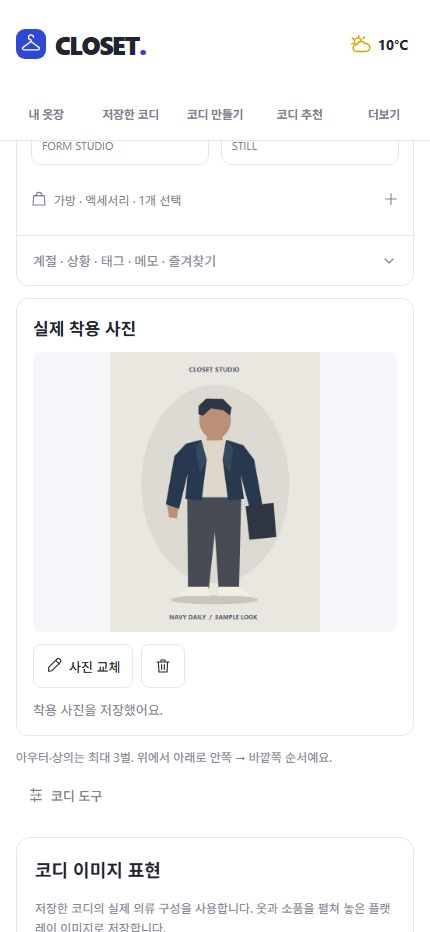 |

</details>

## 기능 한눈에 보기

| 영역 | 할 수 있는 일 |
| --- | --- |
| 의류 관리 | 의류 등록·수정, 종류·세부 분류, 검색·즐겨찾기·정렬, 원화 가격과 구매처 링크, 상태 변경·휴지통·복원 |
| 사진 관리 | 의류당 사진 5장과 대표 사진 선택, 저장한 코디당 착용 사진 1장, 원본 비율 표시와 확대 |
| 코디 이미지 | 보유 의류 사진을 플랫레이로 배치하고 PNG 저장 |
| 스타일 탐색 | 배색 랜덤 선택·찜·비교·이미지 저장, 스타일 가이드, 헤더 날씨 |
| 개인화 | 화이트·베이지·다크 테마, 프로필, 기본 정렬·카드 밀도, 브랜드·로고, 분류 편집·삭제·드래그 정렬 |
| 내 데이터 | 이메일 로그인·재설정, 계정별 저장 공간, JSON·열람용 CSV ZIP·사진 포함 ZIP, 동일 계정 복원과 전송 재개. [백업·복원 화면](docs/portfolio/backup.jpg) |

## 구현 포인트

- **웹·모바일 공용 화면** — Expo Router와 React Native로 PC 웹, 모바일 웹, iOS·Android의 화면과 로직을 공유합니다. 넓은 화면에서는 코디 보드와 옷장 목록을 나란히 배치합니다.
- **규칙 기반 코디 추천** — 보유 의류의 색상 조화를 중심으로 소재·계절·스타일과 사용자 조건을 반영합니다. 선택한 아이템을 고정한 채 다른 조합을 탐색할 수 있습니다.
- **계정별 데이터 경계** — Supabase Auth와 PostgreSQL 행 수준 보안으로 데이터를 나누고, 비공개 Storage의 사진은 만료되는 서명 URL로 표시합니다. 기본 사용량 한도는 의류 300개, 이미지 500개·합계 100MiB입니다.
- **실사용 기록과 복원** — 착용 당시 의류 정보를 별도로 보관하고, 사진 포함 백업에 의류 사진·로고·코디 이미지·착용 사진을 담습니다. 복원 전 대상과 변경 범위를 확인할 수 있습니다.

[폴더·데이터 구조](docs/ARCHITECTURE.md) · [데이터 분리·보안](docs/SECURITY.md) · [백업·복원](docs/BACKUP_RESTORE.md)

## 로컬에서 실행

Node.js 22.23.x, npm, Docker Desktop의 Linux 엔진이 필요합니다.

```powershell
npm ci
npm run db:start
npm run db:migrate
npm run env:local
npm run web
```

공용 데이터 연결이나 기존 `.env.local` 전환은 [환경 설정 안내](docs/ENVIRONMENT.md)를 참고하세요.

| 명령 | 검증 범위 |
| --- | --- |
| `npm run check` | TypeScript, ESLint, 단위 테스트 |
| `npm run db:test` | 로컬 DB·Auth·Storage 통합 테스트 |
| `npm run export:native` | Android·iOS 번들 생성 |
| `npm run build` | 공용 Supabase를 사용하는 웹 빌드와 산출물 검사 |

[프로젝트 현황](docs/PROJECT_STATUS.md) · [실사용 검증 기록](docs/USABILITY_VALIDATION.md) · [운영 배포](docs/CLOUD_DEPLOYMENT.md)
