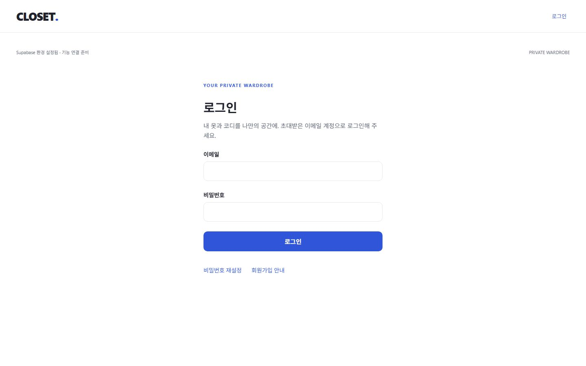
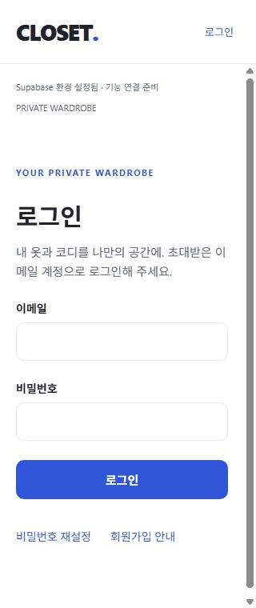

# 2단계: DB 보안과 이메일 인증

검증일: 2026-10-28 (Asia/Seoul). 실제 Docker 기반 로컬 Supabase / PostgreSQL 17.11에서 검증했다. 호스팅 프로젝트 연결·배포는 수행하지 않았다.

## 구현 범위

- 원본 SQL 기반 초기 migration과 보안 보완 migration 2개.
- 개인 테이블 RLS, 교차 회원 복합 FK, invoker 통계 view, 명시적 table/function 권한.
- 본인 의류/DB 예약과 연결된 private 사진 경로. 최대 5개 슬롯, 5MiB/MIME 제한, 예약 잠금, 파일이 남은 예약 삭제 거부.
- 이메일 로그인/가입 요청 UI, 서버 가입 제한, 세션 복원/로그아웃, 보호 라우트, PKCE 재설정 이메일/복귀/비밀번호 변경.
- 생성 DB 타입과 typed Supabase client, 공통 폼/버튼, 한국어 오류/로딩/중복 제출 방지.
- 로컬 연결 환경값 생성과 자체 fixture만 생성·정리하는 테스트 도구. 서버 키는 앱 환경 파일에 기록하지 않는다.

## 검증 결과

| 항목 | 결과 | 근거 |
| --- | --- | --- |
| 로컬 마이그레이션 최초 적용 | PASS | Supabase 신규 DB에 SQL 2개 적용 |
| 빈 DB에서 migration 재현 | PASS | 개인 데이터/계정/Storage 객체 0건 확인 후 `supabase db reset --local` 재적용 |
| DB lint | PASS | `supabase db lint --local --level warning`, schema 오류 없음 |
| TypeScript / ESLint | PASS | `npm run check`, 오류/경고 0 |
| 단위 테스트 | PASS | Vitest 5개 파일, 22개 테스트 |
| 실제 API/SQL 통합 테스트 | PASS | `npm run db:test`, 13개 테스트. reset 후에도 모두 통과 |
| Expo Doctor / 의존성 호환 | PASS | 20/20 checks / expo install --check |
| Web export | PASS | dist/index.html 및 웹 번들 생성 |
| Android/iOS export | PASS | 양 플랫폼 Hermes 번들 생성. 실기기 검증의 대체는 아님 |
| 공개 번들 서버 키 검사 | PASS | `node scripts/check-public-bundle.mjs`, JS/Hermes/HTML/JSON 산출물 23개에서 실제 로컬 service_role 키 미검출 |
| Web Auth smoke | PASS | 실제 임시 계정 로그인/새로고침 복원/로그아웃/보호 URL 차단 |
| Web recovery smoke | PASS | 재설정 요청 → 로컬 메일 검증 → callback → 새 비밀번호 화면. 브라우저에서는 새 비밀번호 제출 없이 종료했고 실제 변경은 API 테스트로 검증 |
| Web 오류 처리 | PASS | 닫힌 회원가입의 한국어 안내, 잘못된 PKCE 링크 오류 화면과 코드 URL 제거 |
| 반응형 Auth 폼 | PASS | 가입 화면 320/390/1280/1440px에서 document 및 내부 요소의 가로 넘침 0 |
| 네이티브 실기기 / custom scheme | NOT RUN | Windows 환경에 실기기/에뮬레이터 연결 없음 |
| 공개 신규 가입의 확인 메일 완주 | NOT RUN | 기본 가입 정책을 닫아 두었음. 거부 경로는 API와 UI에서 검증 |
| 원격 SMTP / 운영 RLS | NOT RUN | 호스팅 서비스/실제 발신 도메인 미연결 |

## 통합 테스트가 확인한 내용

1. A/B의 profiles, wardrobe_items, item_images, outfits, outfit_items, wear_events, wear_event_items, import_jobs와 통계 view의 회원별 분리.
2. 타인 행 UPDATE 영향 0건, 소유자 위조 INSERT/변경과 의류 hard delete 차단.
3. 익명 개인 테이블 접근 및 회원의 전역 카테고리 수정 차단.
4. RLS를 우회하는 fixture 관리자 요청도 교차 회원 FK INSERT/UPDATE 실패. 회원의 미구현 코디/착용 직접 쓰기는 별도 권한으로 차단.
5. 타인 사진 download/upload/update/move/signed URL/list/delete 차단과 원본 보존.
6. 사진 경로/예약/의류 소유권 연결, 경로 변경/파일이 남은 예약 삭제/덮어쓰기 차단.
7. 5번째 슬롯 동시 등록에서 한 요청만 성공, 6번째 슬롯/5MiB 초과/미지원 Content-Type 거부.
8. SQL 트랜잭션에서 업로드 권한을 검사하는 동안 예약 삭제가 대기하고, 삭제된 예약으로 뒤늦은 업로드가 거부됨.
9. 보관/삭제된 의류의 새 업로드 거부, 기존 본인 이미지 읽기 유지.
10. import 결과/상태 위조와 잘못된 도메인 값 거부.
11. 코디 수정/삭제 후 과거 착용 구성 보존.
12. 실제 비밀번호 로그인/세션 복원/로그아웃/폐기된 refresh token 거부 및 로컬 세션 제거.
13. 실제 로컬 재설정 이메일의 PKCE 교환, PASSWORD_RECOVERY 이벤트, 임시 비밀번호 변경/새 비밀번호 로그인/코드 재사용 거부. 관계가 있는 계정의 DB cascade 삭제도 확인.

service_role은 fixture 준비/정리와 FK 독립 검증에만 사용한다. 회원 분리 판정은 실제 로그인한 A/B와 anon 요청으로 수행했다. 테스트는 loopback 54321만 허용한다. UI fixture는 별도로 만든 임시 계정이며 검증 후 계정/메일/인증값 파일을 정리했다.

## 제한과 다음 작업

- 의류/사진 CRUD 화면, 코디/착용 저장 RPC, 프로필/테마 기기간 저장은 아직 없다. 코디/착용 직접 쓰기 권한을 닫은 상태에서 해당 단계의 RPC를 추가한다.
- MIME allowlist는 선언된 Content-Type 제한이다. 실제 파일 바이트/디코딩/이미지 변환 검증은 W02에서 구현한다.
- 네이티브 SecureStore의 실기기 저장/복원, 기기간 동기화, production HTTPS 환경과 공개 가입 완주를 추가 검증해야 한다.
- production export에 로컬 HTTP 설정을 사용하면 연결을 거부하도록 설계했다. 배포에는 HTTPS Supabase 환경값과 실제 callback allowlist가 필요하다.
- 초기 audit의 Expo 전이 의존성 경고 8건은 남아 있다. 의존성 변경은 없었으며 이번 단계에서 강제 override/다운그레이드를 적용하지 않았다.
- 다음: A04 회원별 저장소/Query 연결 → W01 의류 수동 등록/상세 → W02 비공개 이미지 업로드 UI.

근거: [Supabase 로컬 개발](https://supabase.com/docs/guides/local-development/cli-workflows), [Auth 딥링크](https://supabase.com/docs/guides/auth/native-mobile-deep-linking), [테스트/린트](https://supabase.com/docs/guides/local-development/cli/testing-and-linting).

