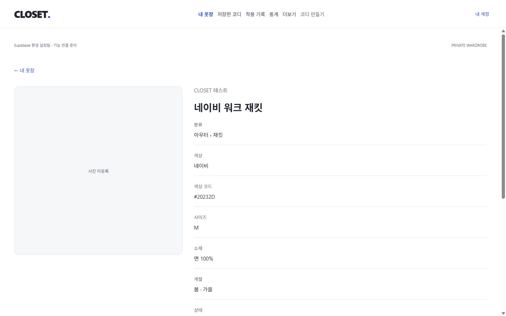
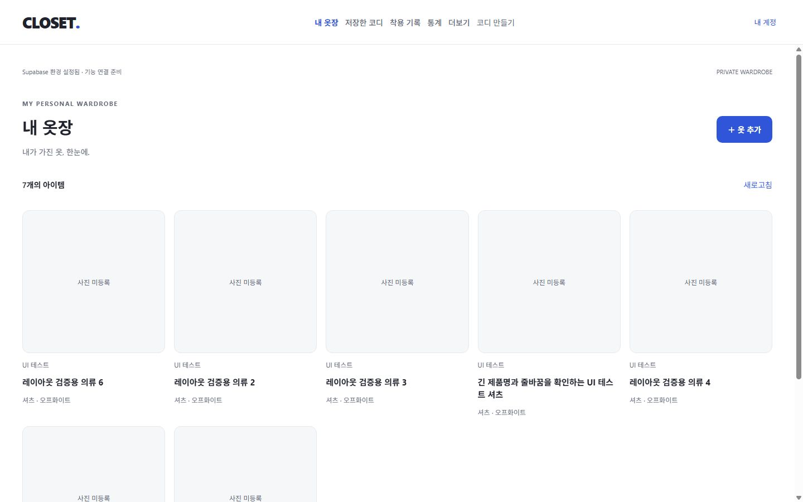
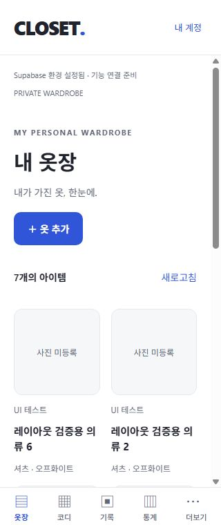

# 3단계: 회원별 의류 수동 등록·조회

검증일: 2026-10-28 (Asia/Seoul). A04의 옷장 저장소/Query 연결과 W01을 구현했다. 호스팅 배포/새 DB migration/사진 업로드 UI는 이번 범위에 포함하지 않았다.

## 구현

- `/wardrobe/new`: 제품명과 대분류 필수, 세부 분류/브랜드/색상/사이즈/계절/소재/태그/구매가/통화/구매일/구매처 링크/메모 선택 입력.
- `/wardrobe`: 실제 회원 데이터, 사진 없는 반응형 카드, 총 개수, 새로고침, 최신순/ID 안정 정렬, 20개 단위 페이지.
- `/wardrobe/[itemId]`: 실제 재조회와 상세 정보, 사진 placeholder, 잘못된 ID/없는 항목/타인 항목/통신 오류 처리.
- DB 생성 타입을 사용한 repository와 회원별 Query key, HTTP AbortSignal, 저장 후 같은 회원의 캐시 무효화.
- 폼 실행 중 안전한 UUID 유지, 중복 클릭 차단, 저장 오류 시 입력 보존. 응답 유실 후 같은 ID/내용 재시도는 기존 행을 반환하고 다른 내용은 덮어쓰지 않는다.
- 가격 공란/null과 0원 구분, 천 단위 쉼표/소수 둘째 자리, 실제 달력 날짜, HTTPS 링크, DB와 맞춘 필드/태그/계절 검증. DB 오류 세부 내용은 UI에 노출하지 않는다.
- `expo-crypto`만 추가했다. 환경 변수와 외부 서비스 추가는 없다.

## 검증

| 항목 | 결과 | 범위 |
| --- | --- | --- |
| TypeScript / ESLint | PASS | 오류/경고 0 |
| 단위 테스트 | PASS | 6개 파일, 41개 테스트 |
| 실제 DB/Auth/Storage 보안 | PASS | 기존 node 통합 테스트 13개 |
| 실제 옷장 repository | PASS | 추가 Vitest 통합 테스트 4개 |
| Expo Doctor / SDK 호환 | PASS | 20/20 checks / expo install --check |
| Web export | PASS | 웹 산출물 생성 |
| Android/iOS export | PASS | 양 플랫폼 Hermes 번들 생성 |
| 공개 번들 서버 키 검사 | PASS | 산출물 25개에 실제 로컬 service_role 키 미검출 |
| Web 등록/목록/상세 | PASS | 실제 임시 계정으로 선택 필드 입력·저장·상세 이동·새로고침 재조회·목록 반영 |
| Web 오류 복구 | PASS | REST 서비스를 잠시 중단해 저장 오류 발생 → 입력값 유지 → 서비스 복구 후 재시도 저장 |
| Web 계정 격리 | PASS | A 조회 후 로그아웃/B 로그인 → 빈 목록. A의 상세 URL 직접 접근 → 찾을 수 없음 |
| Web 입력/주소 검증 | PASS | 필수값 누락 안내, 잘못된 UUID 경로 처리 |
| 반응형 | PASS | 등록/상세 320/390/1280/1440px, 목록은 768px도 포함해 가로 넘침 0 |
| 네이티브 실기기/기기간 동기화 | NOT RUN | 연결된 기기/에뮬레이터 없음. 번들은 컴파일 검증 |

새 repository 통합 테스트는 실제 Supabase에서 선택 필드/메모 보존, 타 회원 get=null, 페이지 중복 없음과 soft delete 제외, 동일 ID 재시도/다른 내용 충돌, 서버 commit 후 응답 유실 복구, 잘못된 분류 거부 및 이미 취소된 요청을 검증했다. 단위 테스트는 가격/날짜/URL/태그/소유자 whitelist/HTTP 취소/회원별 key를 검증한다.

브라우저에서 등록한 1개 항목과 해당 임시 계정에 추가한 레이아웃 fixture 6개로 목록을 점검했다. 이 데이터는 앱 기본 데이터가 아니며 테스트 종료 후 두 계정과 함께 삭제했다. 정리 후 auth.users/wardrobe_items/Storage 객체가 모두 0건임을 확인했다. 오류 복구 시험 후 REST 서비스는 정상 복구했다.

| 너비 | 안정화 후 카드 열 수 | 가로 넘침 |
| --- | --- | --- |
| 320 / 390 | 2 | 없음 |
| 768 | 3 | 없음 |
| 1280 | 4 | 없음 |
| 1440 | 5 | 없음 |

## 제한과 다음 작업

- 사진 업로드/표시, 수정·즐겨찾기·보관·삭제 조작 UI는 후속이다. 현재 사진 없는 등록이 정상 흐름이다. 기존 이미지가 있는 데이터를 위한 사진 렌더링도 W02에서 연결한다.
- 검색/분류·상태 필터/추가 정렬과 150–300개 대량 데이터 성능 검증은 W03에 남아 있다. 현재 목록은 삭제되지 않은 모든 상태를 표시한다.
- 저장 실패 입력 보존/요청 ID 재사용은 현재 폼 생명주기 안에서 지원한다. 새로고침/앱 종료 후의 임시 초안 복원은 아직 없다.
- 네이티브 키보드/카메라 권한/실기기 세션과 기기간 갱신은 실제 기기로 검증해야 한다. 원격 SMTP/운영 환경도 별도다.
- Expo 전이 의존성 경고는 기존 8건이며 SDK 호환성을 깨는 강제 override는 적용하지 않았다.
- 다음: W02 비공개 이미지 선택·변환·업로드·실패 복구 → W03 검색/필터/정렬 → W04 의류 편집/상태 관리.

요청 취소 근거: [TanStack Query](https://tanstack.com/query/latest/docs/framework/react/guides/query-cancellation), [Supabase AbortSignal](https://supabase.com/docs/reference/javascript/using-modifiers-abortsignal).

