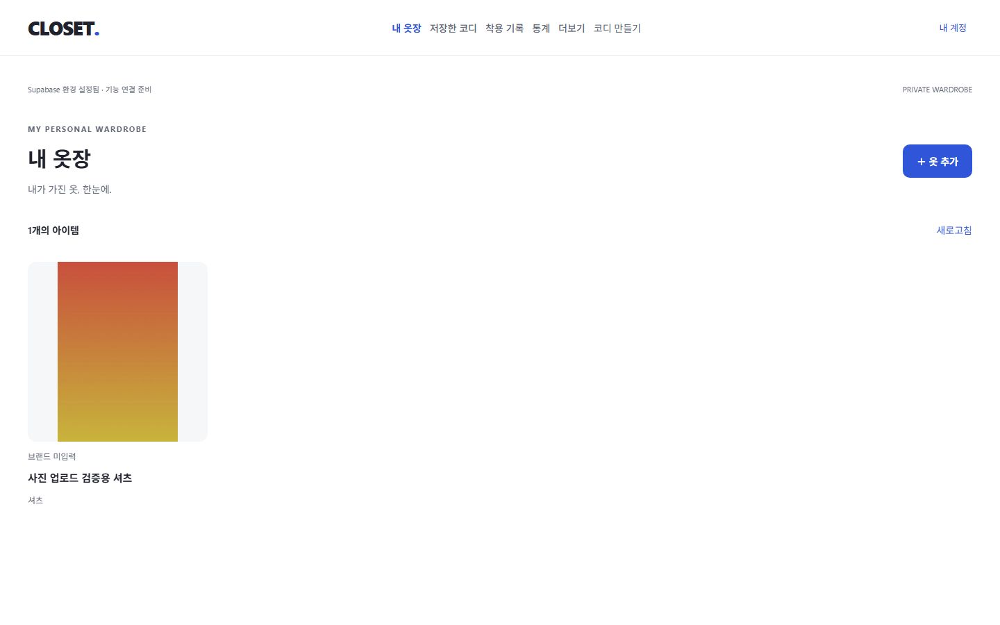
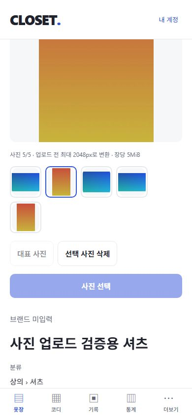
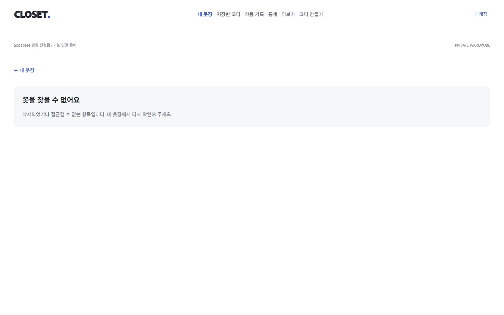

# 4단계: 회원별 비공개 사진 업로드

검증일: 2026-10-28 (Asia/Seoul). W02의 사진 선택·변환·업로드·표시·대표 지정·실패 복구를 구현했다. 검색/필터/정렬, 의류 편집, 코디와 원격 배포는 이번 범위에 포함하지 않았다. 원본 기획서/SQL/프롬프트는 수정하지 않았다.

## 구현

- 의류를 먼저 저장한 뒤 상세 화면에서 총 5장까지 사진 선택. 모바일 카메라 버튼/권한 설명과 웹 파일 선택을 분리했다.
- 원본 30MiB/3,600만 화소 제한, 시그니처 검사와 실제 디코딩 후 긴 변 최대 2048px, 비율 유지 WebP 재인코딩. 웹 WebP 인코더 미지원은 흰 배경 JPEG fallback. 변환 출력은 5MiB 이하로 검사한다. 업로드 원본을 변경/삭제하지 않는다.
- 새 이미지 UUID 예약 → private Storage 업로드 → 완료 RPC. pending도 5장 제한에 포함하며 ready 사진만 표시한다. 동시 예약은 의류 잠금/고유 슬롯으로 제한한다.
- 첫 완료 사진을 대표로 지정하고 상세 썸네일에서 대표 교체. 목록은 대표 이미지를 `contain`으로 표시한다. 삭제 RPC는 다음 ready 사진을 대표로 선택한다.
- 업로드/완료 응답 유실 시 같은 ID와 변환 바이트로 재시도. 저장 파일이 있으면 정확한 바이트를 비교하며 다른 파일을 덮어쓰지 않는다. 화면 생명주기 안에서는 재시도용 변환 바이트를 메모리에 유지한다.
- 앱 재접속 후 pending 예약에 업로드 마무리/미완료 사진 정리 제공. 파일 삭제 → metadata 삭제 순서로 실패 중간 상태도 재시도할 수 있다. 자동 만료/백그라운드 orphan 수거는 없다.
- 시작 회원 토큰을 고정한 서비스와 Storage/RPC AbortSignal, 회원별 사진 Query, 계정 교체 시 취소/캐시 제거. signed URL은 TTL 60초, 조회 중 45초 갱신이며 영구 저장하지 않는다.
- SQL migration 3개 추가(총 5개), DB 타입 재생성. 사진 완료/대표 컬럼 직접 위조와 ready 경로 재삽입을 차단했다. 추가 외부 서비스/환경 변수는 없다.

## 검증

| 항목 | 결과 | 범위 |
| --- | --- | --- |
| TypeScript / ESLint | PASS | 오류/경고 0 |
| 단위 테스트 | PASS | 7개 파일, 45개 테스트 |
| DB/Auth/Storage 통합 | PASS | node 13개 + Vitest 10개 = 23개 |
| 빈 로컬 DB 재현 | PASS | fixture/파일 0건 확인 후 reset, migration 5개 순차 적용, 통합 테스트 재실행 |
| SQL lint | PASS | public/app_private schema errors 없음 |
| Expo Doctor / SDK 호환 | PASS | 20/20 checks / expo install --check |
| Web export | PASS | 최신 웹 번들 생성 |
| Android/iOS export | PASS | 양 플랫폼 Hermes 번들 생성. 기기 실행과 구분 |
| 공개 번들 서버 키 검사 | PASS | 최종 웹 산출물 22개에 실제 로컬 service_role 키 미검출 |
| Web 실제 사진 업로드 | PASS | PNG 가로/세로 다중 선택 → WebP 변환 → 실제 Storage 저장 → 상세 표시 |
| Web 리사이즈 | PASS | 3200×2400 → 2048×1536, 비율 유지 및 이미지 로드 확인 |
| Web 잘못된 파일 | PASS | SVG 선택 시 업로드 전 거부, 예약 슬롯 생성 없음 |
| Web 대표 사진 | PASS | 두 번째 사진으로 교체, 재조회/목록에 세로 사진 반영 |
| Web 통신 오류 | PASS | Storage 서비스 일시 중단 → 오류/재시도 표시 → 서비스 복구 후 같은 작업 성공 |
| Web 중단 후 복구 | PASS | 파일 업로드만 끝낸 pending 예약 생성 → 상세 재접속 → 업로드 마무리 → ready 5장 |
| Web 최대 5장 | PASS | ready 5장에서 사진 선택 비활성. API 동시 6개 요청은 5개만 성공 |
| Web 회원 격리 | PASS | A 로그아웃/B 로그인 → 빈 목록, A 상세 주소 접근 거부, 개인 img 0개 |
| 상세 반응형 | PASS | 320/390/1280/1440px 가로 넘침 없음, 390px 썸네일 줄바꿈 |
| 네이티브 기기/권한/카메라/HEIC | NOT RUN | 연결 기기/에뮬레이터 없음. 번들 컴파일만 검증 |

사진 통합 테스트 6개는 실제 로컬 Storage/RPC를 사용한다. 파일 존재/서명 URL 내용 일치, 타인 서명·완료·대표 거부, 직접 상태 위조 거부, 동시 5장 제한/대표 변경, 업로드와 완료 응답 유실 복구, 다른 바이트 재시도 거부, pending 완료/정리, 객체보다 먼저 metadata 삭제 거부, 삭제 후 대표 대체, ready 경로 재삽입 거부, 취소/회원 불일치를 확인한다. 나머지 17개는 기존 인증/보안/의류 저장소 회귀 검증이다.

브라우저용 사진은 직접 만든 단색 그라데이션 PNG이며 개인 사진/레퍼런스 상품 이미지를 업로드하지 않았다. 브라우저에서 4장을 업로드하고 앱 종료 상황을 재현한 pending 1장을 마무리했다. 테스트 종료 후 해당 파일을 먼저 삭제하고 두 fixture 계정/메일/인증 파일을 정리했다. auth.users / wardrobe_items / item_images / storage.objects가 모두 0건임을 확인했다. Storage 서비스는 복구했고 개발 서버는 유지했다.

## 제한과 다음 작업

- 네이티브 사진첩/카메라 권한 거부·재허용, HEIC/방향 정보/투명 이미지, 앱 백그라운드 종료와 실제 두 기기 동기화는 실기기 검증이 필요하다. 웹 HEIC 지원은 브라우저 디코더에 의존하며 미지원 파일은 JPEG/PNG/WebP로 다시 선택하도록 안내한다.
- 서버는 Storage의 객체 존재/크기/MIME/경로를 검증한다. 앱 시그니처/디코딩/재인코딩 검증을 우회한 직접 API 호출에 대해 서버가 바이너리까지 디코딩하는 것은 아니다. 공개 서비스 전 서버 검증/격리 과제가 남아 있다.
- 발급된 signed URL은 bearer 링크이며 60초 만료 전까지 유효할 수 있다. 계정 전환은 앱 캐시/화면/요청을 정리하며 링크 자체를 즉시 폐기하지 않는다.
- pending 예약을 화면에서 정리하기 전까지 슬롯을 점유한다. 새로고침하면 업로드 전 메모리 초안은 사라진다. 서버에 올라간 파일은 pending 마무리, 올라가지 않은 예약은 정리 후 새 선택으로 복구한다.
- 삭제의 DB/Storage 순서와 재시도는 API로 검증했다. 브라우저의 영구 삭제 확인 수락은 자동 수행하지 않았다.
- 기존 의존성 audit 경고 8건(3 high/5 low)은 남아 있으며 호환성을 깨는 강제 override는 적용하지 않았다.
- 다음 작업은 W03: 검색/분류·색상·즐겨찾기·상태 필터/정렬과 150–300개 목록 검증이다. 이후 W04 의류 편집·상태 관리로 진행한다.

사진이 표시된 검증 화면(테스트 이미지):

