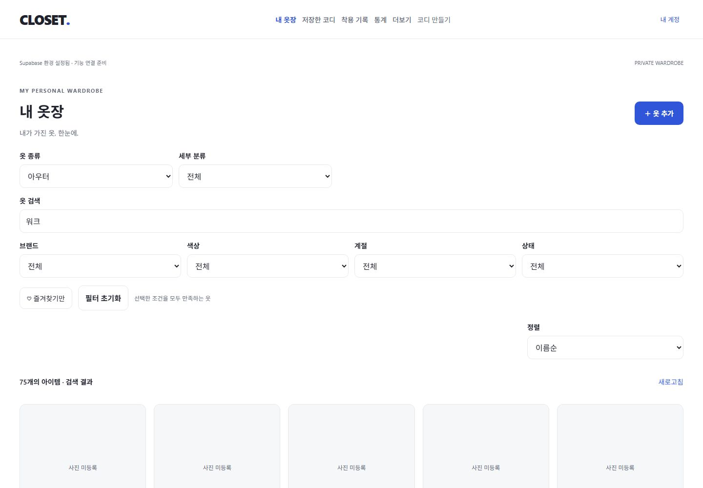
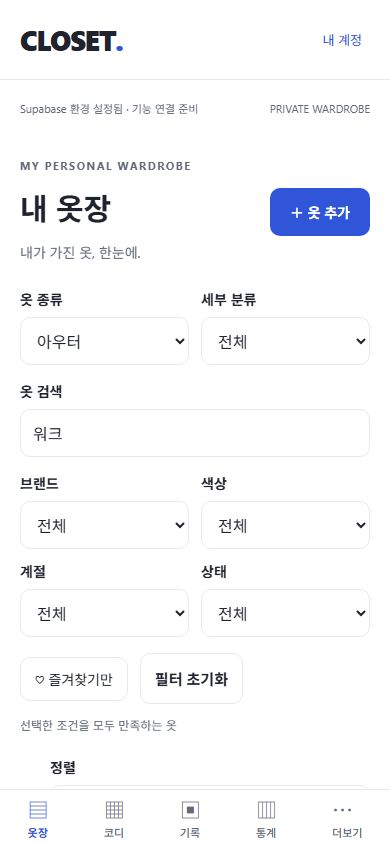
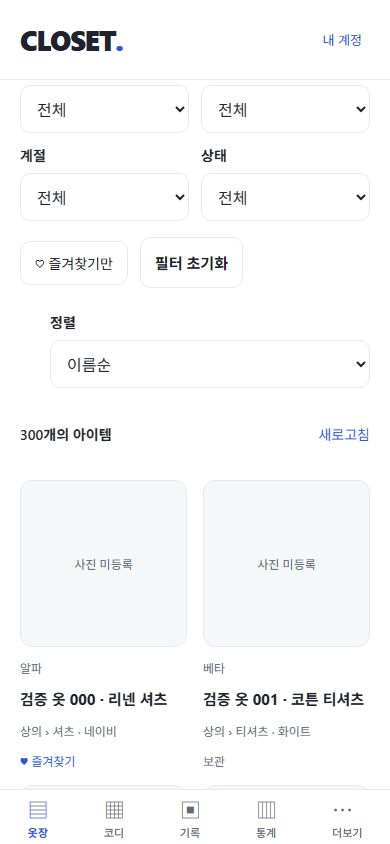

# 5단계: 검색·필터·정렬과 300개 목록

검증일: 2026-10-28 (Asia/Seoul). W03을 구현했다. 즐겨찾기/상태 변경, 의류 편집·삭제 조작은 W04로 유지한다. 원본 기획서/SQL/프롬프트/레퍼런스는 수정하지 않았다.

## 동작

- 이름/브랜드/색상을 대소문자 무시 부분 일치로 검색한다. 검색어는 200자까지, 350ms 지연 또는 키보드 검색 제출로 적용한다. `%`, `_`, 쉼표, 괄호, 따옴표, 역슬래시는 검색 문법이 아닌 문자다.
- 대분류(자신+하위), 세부 분류, 브랜드, 색상, 계절, 즐겨찾기만, 보유/보관/판매/기부 상태를 AND로 조합한다. 대분류 변경 시 세부 분류를 초기화한다. 계절 필터는 한 번에 한 계절이며 의류의 복수 계절 중 포함 여부를 확인한다.
- 브랜드/색상 선택지는 본인의 삭제되지 않은 전체 옷장에서 가져온다. null/공백은 제외하며 다른 필터에 따라 선택지를 줄이지 않는다. 브랜드/색상 필터는 정확히 일치한다.
- 최근 등록/오래된 등록/이름/브랜드/구매가 낮은순·높은순. 가격은 통화 코드별로 묶어 같은 통화 안에서 정렬하며 가격 미입력은 마지막, 0원은 유효한 값이다. 모든 정렬은 생성 시각/ID로 동률을 해소한다.
- 필터/정렬 변경 시 페이지 1로 이동한다. 20개 단위로 서버에서 조회하고 필터가 적용된 전체 개수를 표시한다. 다른 기기에서 삭제돼 현재 페이지가 사라지면 재집계하고 마지막 유효 페이지로 이동한다.
- 검색 결과 없음과 처음 등록 전 빈 옷장을 구분한다. 요청 실패 시 조건을 유지하고 재시도를 제공한다. 필터 초기화는 검색어/정렬/페이지도 초기화한다.
- `SelectField`는 웹 label/select, 네이티브 Modal/라디오 목록을 사용한다. 모바일 필터는 두 열, PC는 분류 두 열과 추가 조건 네 열로 배치한다. 카드에 대분류/세부 분류와 즐겨찾기 상태를 표시한다.
- 읽기 전용 검색/선택지 RPC 2개를 추가했다. security invoker/RLS 및 auth.uid()/요청 소유자 일치, anon 실행 차단을 적용했다. RPC에는 값만 전달하며 동적 SQL/검색어를 조합한 PostgREST 필터는 사용하지 않는다. 모든 조건/페이지는 회원별 Query key에 포함하고 요청 취소를 연결한다.
- 신규 패키지/환경 변수/외부 서비스는 없다. migration 1개 추가(총 6개), DB 타입 재생성. 원격 배포는 수행하지 않았다.

## 검증 결과

| 항목 | 결과 | 범위 |
| --- | --- | --- |
| TypeScript / ESLint | PASS | 오류/경고 0 |
| 단위 테스트 | PASS | 8개 파일, 48개 테스트 |
| 실제 DB/Auth/Storage 통합 | PASS | node 13개 + Vitest 14개 = 27개 |
| DB migration / SQL lint | PASS | 로컬 적용 및 schema errors 없음 |
| 빈 DB 재현 | PASS | 테스트 데이터 0건 확인 후 reset, migration 6개 적용 및 통합 테스트 재실행 |
| Expo Doctor | PASS | 20/20 checks |
| Web export | PASS | 최신 웹 번들 생성 |
| Android/iOS export | PASS | Hermes 번들 생성, 실제 기기 실행과 구분 |
| 공개 산출물 서버 키 검사 | PASS | 웹/네이티브 총 25개에서 실제 로컬 service_role 키 미검출 |
| 300개 전체 페이지 | PASS | 실제 회원 API로 15페이지×20개, 고유 ID 300개/중복·누락 없음 |
| 복합 필터와 개수 | PASS | 상의 225, 셔츠 75, 아우터 75, 브랜드/색상/계절/상태 각각 75, 즐겨찾기 60, 조합 조건 15 |
| 정렬 | PASS | 이름/브랜드/null, 최근/오래된 시각, 통화별 가격/0원/미입력, 동률 재조회 순서 |
| 검색/선택지 격리 | PASS | 특수문자 리터럴 검색, 타인/soft delete 제외, p_owner 위조 결과 0, anon RPC 거부 |
| Web 조작 | PASS | 분류·세부/브랜드·색상·계절·상태·즐겨찾기 조합, 정렬, 페이지 이동, 지연 검색, 초기화, 빈 결과 |
| Web 통신 오류 | PASS | REST 일시 중단 → 검색 오류 → 조건 유지 → 서비스 복구/다시 시도 성공 |
| Web 데이터 감소 | PASS | 두 번째 페이지에서 fixture 300→20개로 감소 → 새로고침 → 첫 페이지로 보정 |
| Web 계정 교체 | PASS | A 로그아웃/B 로그인 → 본인 1개, 브랜드·색상 선택지도 B 값만 표시 |
| 네이티브 실기기 | NOT RUN | 모달 선택/키보드/터치/기기 간 동기화는 실제 기기 확인 필요 |

| 너비 | 목록 열 수 | 입력/카드 가로 넘침 |
| --- | --- | --- |
| 320 / 390px | 2 | 없음 |
| 768px | 3 | 없음 |
| 1280px | 4 | 없음 |
| 1440px | 5 | 없음 |

로컬 API 성능 표본은 브라우저용 fixture 300개를 로그인한 회원 토큰으로 15회 페이지 조회한 결과다. 평균 **16ms**, 최대 **45ms**였다. 요청에는 exact count가 포함된다. 이는 개발 PC/loopback/따뜻한 로컬 DB 표본이며 원격 RTT, 실기기 렌더링, 대량 이미지 처리나 운영 부하 성능을 보장하지 않는다. 브라우저 fixture는 사진 없는 긴 제품명/브랜드 누락/모든 상태를 포함한다. 사진 업로드·표시의 기존 회귀는 W02 통합 테스트로 확인했다.

재현: `npm run check`, `npm run db:test`, `npx supabase db lint --local --level warning`, `npx expo-doctor`, `npm run export:web`, `npx expo export --platform android --platform ios --output-dir dist/native`, `node scripts/check-public-bundle.mjs`.

브라우저용 데이터는 `node scripts/ui-fixture.mjs`, `node scripts/ui-fixture.mjs second`, `node scripts/ui-wardrobe-fixture.mjs`로 빈 임시 두 계정에만 생성한다. 마지막 스크립트는 loopback/계정 ID·이메일 일치/기존 옷장 0개를 확인한다. `node scripts/ui-fixture.mjs cleanup`으로 테스트 계정·메일·인증 파일을 정리한다. 종료 후 auth.users/wardrobe_items/item_images/storage.objects 모두 0건임을 확인했고 REST 서비스는 정상 복구했다.

## 남은 작업

- W04: 의류 수정, 즐겨찾기 변경, 보관/판매/기부/soft delete UI와 참조 경고. 현재 즐겨찾기/상태는 표시·조회 필터다.
- 최근 착용순은 P1 착용 기록 데이터가 생긴 뒤 연결한다. 환율 환산·태그/메모 검색·필터 URL 공유/새로고침 복원은 이번 범위에 포함하지 않는다. 필터는 화면 메모리에만 유지한다.
- offset 페이지 방식이므로 조회 중 삽입/수정이 계속되면 페이지 경계가 달라질 수 있다. 같은 데이터의 안정 정렬과 삭제 후 보정을 검증했으며 고정 스냅샷/커서 페이지는 제공하지 않는다.
- 원격 Supabase/모바일 실기기/접근성 보조기기 검증은 후속이다. 기존 의존성 audit 경고 8건은 남아 있고 강제 override는 적용하지 않았다.

설계 근거: [Supabase Database Functions의 실행 권한/RLS](https://supabase.com/docs/guides/database/functions), [공식 supabase-js RPC/count 구현](https://github.com/supabase/supabase-js/blob/master/packages/core/supabase-js/src/SupabaseClient.ts).

