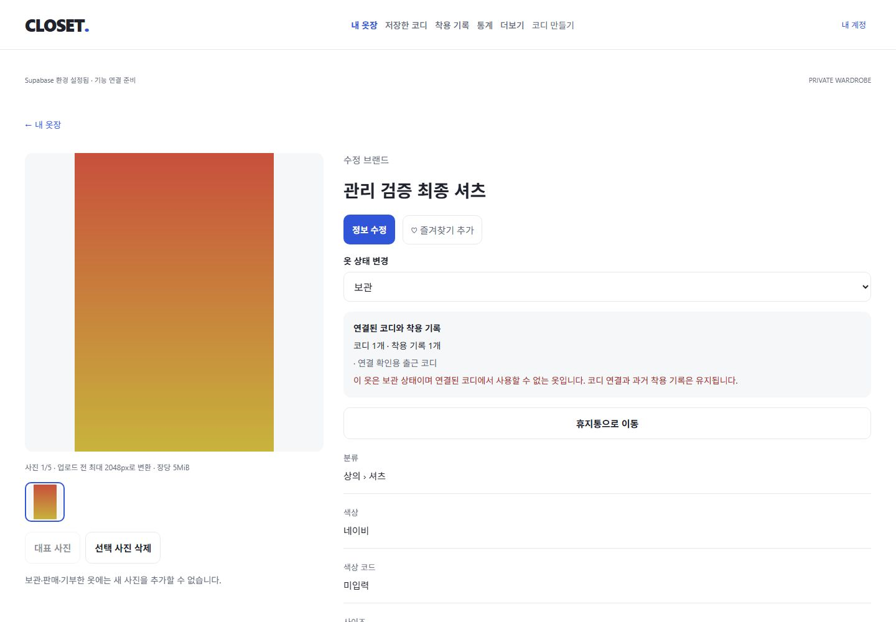
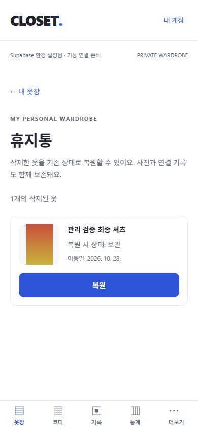

# 6단계: 의류 수정·즐겨찾기·상태·휴지통

검증일: 2026-10-28 (Asia/Seoul). W04의 웹/API 구현을 완료했다. 네이티브는 공통 코드와 번들 컴파일까지 확인했으며 실제 웹↔모바일 기기 동기화는 남아 있다. 코디 편집/착용 기록 화면은 아직 구현하지 않았다.

## 구현

- `/wardrobe/edit/[itemId]`: 등록 폼을 공통 WardrobeForm으로 분리해 모든 등록 필드를 수정한다. 기존 0원/null/계절/태그/날짜를 복원하고 필수·선택 필드 검증을 공유한다. form 필드 whitelist로 소유자/ID/즐겨찾기/상태/삭제 시각을 함께 쓰지 않는다.
- 편집 시작 시 snapshot/updated_at을 유지한다. 배경 재조회가 입력을 덮어쓰지 않으며 네트워크 오류·다른 세션 수정 충돌 시 초안을 보존한다. 최신 정보로 다시 편집/수정 취소는 입력 폐기를 확인한다.
- 수정/즐겨찾기/상태/삭제/복원은 세션 소유자 확인 및 owner/id/updated_at/삭제 여부 조건부 UPDATE를 사용한다. 충돌하면 실패로 안내하고, 응답 유실 뒤 같은 원하는 결과가 이미 저장됐으면 최신 행을 반환한다. 새 버전 컬럼/관리자 쓰기 RPC는 추가하지 않았다.
- 목록 하트는 상세 링크와 분리된 44px 버튼이며 상세에서도 즐겨찾기를 바꾼다. 원하는 boolean을 저장해 중복 toggle을 방지하고, 조회 결과에 따라 즐겨찾기 필터를 갱신한다.
- 상세에서 보유/보관/판매/기부 상태 변경. 상태 변경과 휴지통 이동 전에 연결된 코디/착용 수를 다시 확인한다. 확인을 여는 시점의 version을 유지하며 그 사이 변경됐으면 재확인을 요구한다.
- `wardrobe_item_usage` 읽기 RPC로 삭제되지 않은 본인 코디 수/이름과 착용 참조 수를 표시한다. 비활성 상태이고 연결 코디가 있으면 상세에서 경고한다. 현재 미구현 코디 화면의 슬롯별 경고는 O01–O03 후속이다.
- 일반 삭제는 deleted_at만 설정한다. `/wardrobe/trash`는 20개 페이지 목록과 복원을 제공한다. 사진·코디 연결·과거 착용 연결은 유지하며 복원 시 원래 lifecycle_status로 돌아간다. 영구 삭제/사진 자동 수거/자동 만료는 없다.
- 변경 시 진행 중 개인 조회를 취소한 뒤 상세 캐시/목록·필터 선택지·사진·휴지통을 갱신한다. 재조회는 백그라운드로 실행해 통신 오류가 폼 잠금을 연장하지 않게 했다. 쓰기 작업에 15초 AbortSignal 타이머, 화면/회원 전환 시 취소와 늦은 결과 반영 차단을 연결했다. abort는 서버 rollback 보장이 아니다.
- migration 1개 추가(총 7개), DB 타입 재생성. 신규 패키지·환경 변수·외부 서비스·Realtime 구독·원격 배포는 없다.

## 검증

| 항목 | 결과 | 범위 |
| --- | --- | --- |
| TypeScript / ESLint | PASS | 오류/경고 0 |
| 단위 테스트 | PASS | 9개 파일, 50개 테스트 |
| 실제 DB/Auth/Storage 통합 | PASS | node 13개 + Vitest 21개 = 34개 |
| SQL lint / migration | PASS | 새 migration 로컬 적용, schema errors 없음 |
| 빈 DB 재현 | PASS | 테스트 데이터 0건 확인 후 reset, migration 7개 적용 및 통합 테스트 재실행 |
| Expo Doctor | PASS | 20/20 checks |
| Web / Android / iOS export | PASS | 웹 및 두 Hermes 번들 생성 |
| 공개 산출물 서버 키 검사 | PASS | 총 27개 파일에 실제 로컬 service_role 키 미검출 |
| Web 수정 | PASS | 기존 값 로드 → 이름/브랜드/메모/가격 0원 저장 → 상세 재조회 |
| Web 수정 취소 | PASS | 미저장 입력 경고 → 계속 편집 시 값 유지, 변경 없는 취소는 상세 이동 |
| Web 저장 실패 | PASS | REST 중단 → 오류/입력 보존 → 복구 후 같은 초안 저장. 대기 제한과 백그라운드 재조회 수정 후 재검증 |
| Web 동시 수정 충돌 | PASS | 입력 중 서버에 다른 세션 변경 재현 → 저장 거부/초안 보존 → 확인 후 최신 값으로 교체/다시 저장 |
| Web 즐겨찾기 | PASS | 카드 하트는 상세로 이동하지 않음, 즐겨찾기만 결과에서 해제하면 목록에서 빠짐 |
| Web 상태/참조 안내 | PASS | 변경 취소 시 상태 유지, 보관 확인 후 코디 경고/사진 추가 제한, 코디 1개·착용 1개 유지 |
| Web 휴지통/복원 | PASS | 확인 취소 및 이동 완료 → 일반 목록 0개 → 휴지통 사진 표시 → 복원 → 보관 상태/사진/연결 수 재확인 |
| Web 회원 격리 | PASS | A 로그아웃/B 로그인 → 빈 목록/휴지통, A 수정 URL 접근 거부, 수정 입력/개인 img 0개 |
| 반응형 | PASS | 수정(추가 필드 포함)/상세 관리 320/390/1280/1440px 가로 넘침 없음, 휴지통 320/390/1440px 확인 |
| 네이티브 기기·실제 기기 간 동기화 | NOT RUN | 연결된 기기/에뮬레이터 없음. 두 독립 API 세션의 재조회 동기화와 번들만 검증 |

추가 통합 테스트 7개는 필드 수정/비우기/0원/쓰기 whitelist, 두 독립 로그인 세션의 동시 CAS 충돌과 재조회, edit/favorite/status/delete/restore 각각의 commit 후 응답 유실·같은 version 재시도, 사진 다운로드 바이트/대표 metadata와 코디/착용 연결 보존, 타 회원 변경·휴지통·usage 접근 거부, anon RPC 실행 거부, 휴지통 21개 페이지와 복원 후 count 보정, 취소/세션 소유자 불일치를 확인했다. 나머지 27개는 기존 인증·보안·사진·검색 회귀다.

브라우저 fixture는 직접 생성한 테스트 옷 1개/그라데이션 이미지/코디 1개/착용 연결 1개다. 미구현 코디/착용 쓰기는 fixture용 로컬 admin으로만 만들었고 앱 권한을 열지 않았다. UI에서 이동·복원한 옷/파일과 두 임시 계정·메일·인증 파일은 종료 후 정리했다. auth.users/wardrobe_items/item_images/storage.objects 0건을 확인했으며 REST 서비스는 정상 복구했다. 개발 서버는 유지했다.

재현 명령: `npm run check`, `npm run db:test`, `npx supabase db lint --local --level warning`, `npx expo-doctor`, `npm run export:web`, `npx expo export --platform android --platform ios --output-dir dist/native`, `node scripts/check-public-bundle.mjs`.

UI fixture: 새 `ui-fixture.mjs` A/B 계정 준비 후 `node scripts/ui-management-fixture.mjs`. 충돌은 해당 fixture만 대상으로 `node scripts/ui-management-fixture.mjs conflict`, 정리는 `node scripts/ui-fixture.mjs cleanup`. 스크립트는 loopback 및 계정 ID/이메일 일치를 검사하고 비밀 값을 출력하지 않는다.

## 제한과 다음 작업

- 실제 기기의 키보드·선택창·사진 권한, 다른 기기와의 화면 갱신은 후속 검증이다. Realtime은 없으며 재진입/포커스/새로고침으로 갱신한다.
- 입력 폐기 확인은 수정 취소/최신 내용 교체 버튼에 적용한다. 브라우저 닫기·새로고침·OS 뒤로 가기의 미저장 경고/영구 초안 복원은 아직 없다.
- CAS는 앱 저장소의 충돌 처리 계약이다. 직접 UPDATE 권한을 제거하는 DB 전체 버전 강제 규칙은 아니다. RLS의 소유권 검사는 직접 API에도 유지된다.
- soft delete는 사진을 보존하므로 Storage 사용량도 유지된다. 영구 삭제·자동 만료·계정 탈퇴 시 파일 정리는 운영 단계다.
- 코디 참조 수는 현재 조회 시점의 안내다. 실제 코디 생성/수정에서 활성 의류를 강제하고 비활성 슬롯을 표시하는 일은 다음 단계에 연결한다.
- 원격 환경/SMTP/스토어 빌드는 수행하지 않았다. 기존 의존성 audit 경고 8건은 남아 있고 강제 override는 적용하지 않았다.
- 다음: O01 코디 슬롯 선택·편집 및 미저장 경고 → O02 원자적 코디 저장/수정/복제/삭제 → O03 코디 목록/필터.

API 근거: [Supabase 조건부 update와 결과 반환](https://supabase.com/docs/reference/javascript/update), [필터 적용](https://supabase.com/docs/reference/javascript/using-filters).

