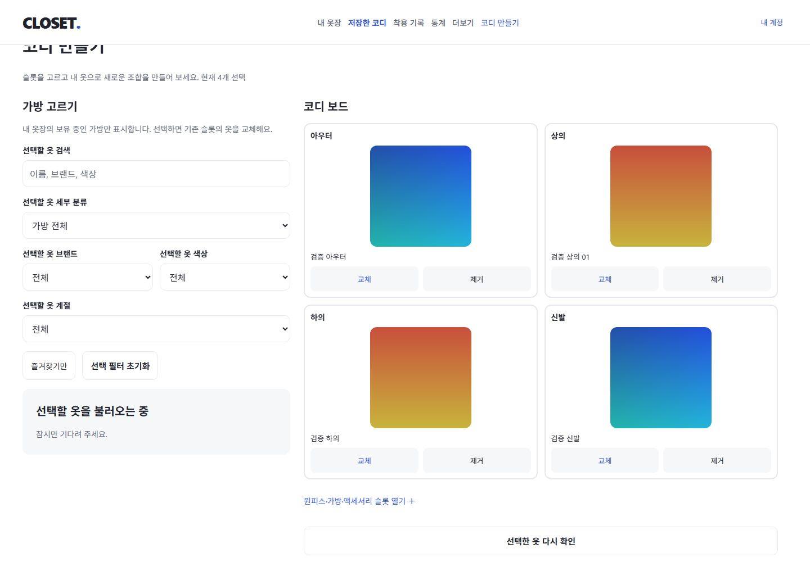
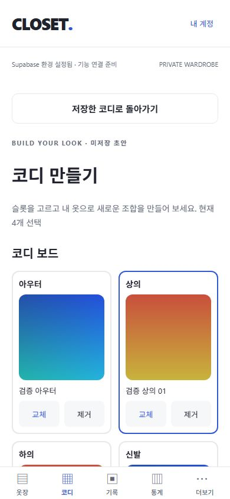
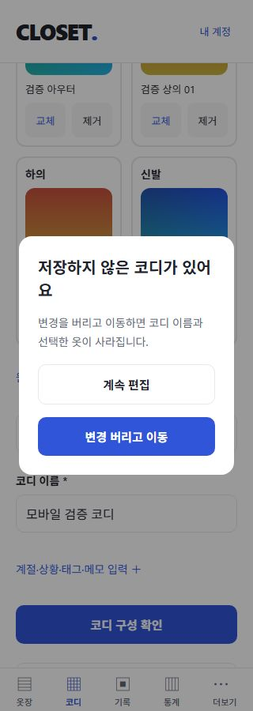

# 7단계: 코디 슬롯 초안 편집

검증일: 2026-10-28 (Asia/Seoul). O01 슬롯 선택·교체·제거/메타데이터/미저장 경고를 구현했다. 서버 저장·기존 코디 편집·복제·삭제는 O02, 저장 목록은 O03이다. 원본 기획서/SQL/레퍼런스는 보존했다.

## 구현

- `/outfits/new`: 기본 아우터/상의/하의/신발 2×2 보드와 원피스·셋업/가방/액세서리 추가 슬롯. 슬롯당 한 벌, position=0이다. 추가 슬롯을 접어도 선택은 유지하며 개수를 표시한다. 같은 옷 중복과 다른 종류 슬롯 배치는 거부한다.
- PC는 좌측 약 35%의 별도 스크롤 선택 패널/우측 보드, 모바일은 보드의 슬롯에서 여는 전체 선택 화면이다. 선택 후보는 본인 active/미삭제/대분류·세부 분류에 맞는 옷만 서버 조회한다. 검색/브랜드/색상/계절/즐겨찾기 필터와 20개 페이지를 제공한다.
- 선택 직전에 새로 조회해 소유자·상태·분류를 검사한다. 선택된 옷은 별도 배치 조회와 30초/포커스/수동 확인을 통해 보관·삭제·분류 변경 경고를 표시한다. 사진은 기존 private Storage의 짧은 signed URL로 렌더링한다.
- 코디 이름/계절 복수/상황/태그/메모/즐겨찾기를 메모리에서 편집한다. 선택·교체·제거는 메타데이터를 유지한다. 초안 비우기는 입력 전체 폐기를 확인한다.
- 구성 확인은 이름/필드 제한/최소 1개/중복/UUID와 현재 의류 상태를 다시 검사한다. 성공 문구에도 미저장 초안임을 표시한다. 코디 DB 쓰기 요청이나 자동 저장은 없다.
- 미저장 메뉴 이동은 공통 GuardedLink, 화면 제거/뒤로 가기는 Expo Router SDK 58 usePreventRemove로 확인한다. 취소하면 초안을 유지하고, 명시적으로 변경 버리고 이동하면 초안을 지운다. 새로고침/닫기는 SDK beforeunload를 연결했으며 실제 브라우저 확인 대화상자는 별도 확인이 필요하다.
- 초안은 컴포넌트 메모리, 조회는 회원별 Query key/취소/epoch 경계를 사용한다. signed URL/토큰을 초안에 저장하지 않는다. 선택·검사 요청에는 15초 abort 타이머를 연결했다. 인증 경계로 직접 화면이 해제되면 개인 초안 폐기를 우선한다.
- 신규 migration/DB 권한/타입/패키지/환경 변수/외부 서비스는 없다. migration은 기존 7개다. outfits/outfit_items 직접 쓰기는 계속 차단한다.

## 검증 결과

| 항목 | 결과 | 범위 |
| --- | --- | --- |
| TypeScript / ESLint | PASS | 오류/경고 0 |
| 단위 테스트 | PASS | 10개 파일, 57개 테스트 |
| 실제 DB/Auth/Storage 통합 | PASS | node 13개 + Vitest 25개 = 38개 |
| Expo Doctor | PASS | 20/20 checks |
| Web / Android / iOS export | PASS | 웹 및 두 Hermes 번들 생성. 실기기 실행과 구분 |
| 공개 산출물 서버 키 검사 | PASS | 웹/네이티브 총 27개에 실제 로컬 service_role 키 미검출 |
| 기본 4슬롯 | PASS | 실제 사진 선택·교체·제거, 이름/태그/메모/계절 유지, 4개 구성 확인 |
| 추가 슬롯 | PASS | 원피스·가방·액세서리 선택, 7개 구성 확인, 접기/펼치기 후 선택 유지 |
| 선택 목록 | PASS | 21개→20/1 페이지, 브랜드/계절/즐겨찾기/검색 조합, 모바일 검색 빈 결과/선택 후 닫힘 |
| 최소 구성 | PASS | 빈 초안은 이름/최소 1개 안내. 잘못된 UUID·종류·중복은 순수 로직/API로 검증 |
| 상태 변경 | PASS | 선택한 상의를 별도 세션에서 보관 처리 → 슬롯 경고/구성 검사 거부 → 다른 옷으로 교체 후 통과 |
| 앱 메뉴/뒤로 가기 | PASS | PC·모바일 메뉴와 브라우저 뒤로 가기 경고, 취소 후 이름/선택 유지, 확인 후 목적지 이동 |
| 초안 비우기 | PASS | 취소 시 유지, 확인 시 이름/선택 전체 초기화, 빈 초안은 경고 없이 이동 |
| 회원 격리 | PASS | A 로그아웃/B 로그인 → 이름/슬롯 비어 있음, A 후보·이미지 0개, B 본인 후보 1개 |
| 미저장 확인 | PASS | UI 검사 후 DB outfits/outfit_items 모두 0건 |
| 반응형 | PASS | 320/390/1280/1440px 입력/버튼/보드 가로 넘침 없음. 모바일 선택 화면도 확인 |
| 새로고침/닫기 네이티브 대화상자 | 추가 확인 필요 | SDK 연결. IAB 새로고침 시 초안은 유지됐으나 활성 JS dialog는 관찰하지 못해 대화상자 동작을 완료로 주장하지 않음 |
| 네이티브 실기기 | NOT RUN | OS 뒤로 가기/스와이프/키보드/선택창과 기기간 동기화는 실제 기기 확인 필요 |

추가 단위 테스트 7개: 슬롯 교체/제거 불변성과 메모 보존, 7개 분류/하위 분류, 타인·비활성·삭제·없는 옷/틀린 슬롯 거부, 분류 순환 종료, 이름/최소 1개/UUID/중복/알 수 없는 슬롯, 메타데이터 길이·정규화·추가 소유자 필드 무시, dirty/초기화 상태.

추가 통합 테스트 4개: 본인 활성 후보 페이지와 상태 필터 강제, 7슬롯 선택 직전 재검사 및 타인·보관·판매·기부·삭제/잘못된 슬롯 거부, 선택 후 상태·분류·삭제 변경의 구성 검사 실패, position=0 반환/서버 미저장/직접 쓰기 차단, 취소 요청/다른 세션 소유자 조회 격리. 나머지 34개는 기존 회귀다.

UI 테스트는 임시 두 회원, 활성 의류 27개/제외 상태 의류/그라데이션 사진 8개로 수행했다. 개인 사진이나 레퍼런스 상품 사진을 업로드하지 않았다. 종료 후 생성한 사진·의류·계정·메일·인증 파일을 정리했다. auth.users/wardrobe_items/outfits/outfit_items/item_images/storage.objects 모두 0건을 확인했다. 개발 서버는 유지한다. 새 migration이 없어 DB reset은 수행하지 않았다.

재현 명령: `npm run check`, `npm run db:test`, `npx expo-doctor`, `npm run export:web`, `npx expo export --platform android --platform ios --output-dir dist/native`, `node scripts/check-public-bundle.mjs`.

UI fixture는 `node scripts/ui-fixture.mjs`, `node scripts/ui-fixture.mjs second`, `node scripts/ui-outfit-fixture.mjs`. 선택 상태 변경은 해당 fixture만 대상으로 `node scripts/ui-outfit-fixture.mjs archive`, 정리는 `node scripts/ui-fixture.mjs cleanup`. loopback과 임시 계정 ID/이메일 일치를 검사하며 인증 값을 출력하지 않는다.

## 제한과 다음 작업

- 이 단계는 새 코디의 메모리 초안이다. 저장·재접속 복구·기존 코디 불러오기·복제·삭제는 아직 없다. 강제 종료/세션 만료/개발 HMR은 초안 보존을 보장하지 않는다.
- 슬롯당 1개이며 원피스와 상·하의의 동시 선택은 금지하지 않는다. 여러 레이어/position 정렬/드래그는 후속이다.
- 상태 확인은 여러 읽기 요청이므로 검사 직후 다시 바뀔 수 있다. O02는 소유권·active·삭제 여부를 저장 트랜잭션 안에서 검증해야 한다.
- 앱 공통 메뉴/뒤로 가기는 웹에서 확인했다. 실제 브라우저 닫기·새로고침의 확인창과 모바일 OS 제스처는 별도 수락 조건이다. 앱 강제 종료/인증 경계는 막지 않는다.
- 원격 배포/운영 부하·기기간 실측은 수행하지 않았다. 기존 의존성 audit 경고 8건은 남아 있다.
- 다음은 O02 원자적 코디 저장·수정·복제·삭제, 이후 O03 저장한 코디 목록/필터다.

근거: [Expo SDK 58 화면 이탈 방지](https://docs.expo.dev/router/advanced/prevent-screen-removal/), [SDK 57→58 전환 안내](https://docs.expo.dev/router/migrate/sdk-57-to-58/).

