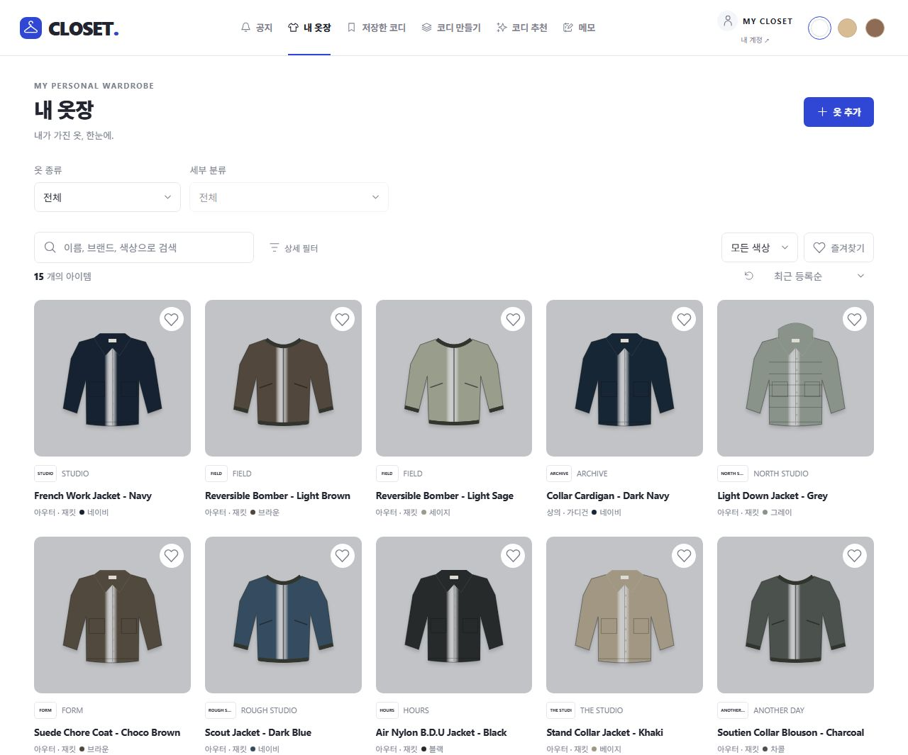
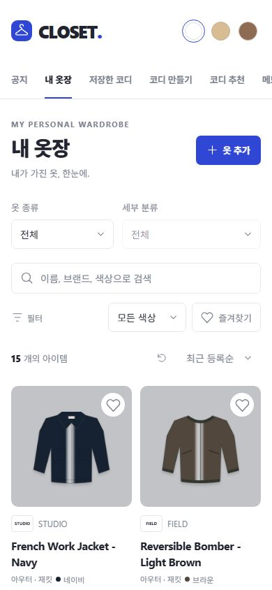
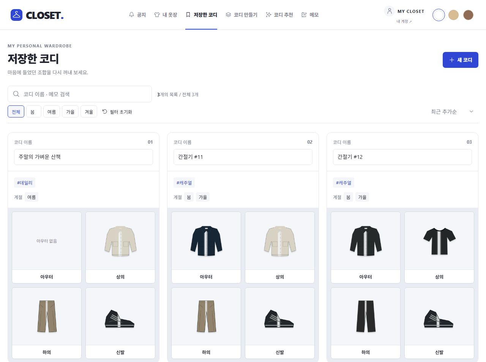
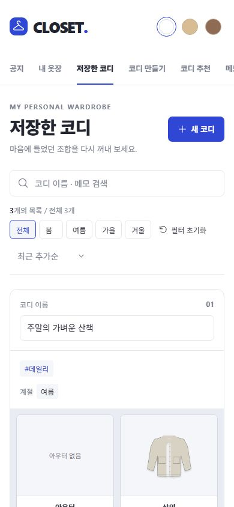

# 레퍼런스 UI 반영 — 2026-10-28

사용자의 “업로드한 이미지 3장처럼 UI/UX 수정” 요청을 우선 적용했다. 원본 PRD/SQL/프롬프트와 이미지는 보존했다. 기존 하단 탐색과 1440px 기준 5열 결정은 이번 직접 요청에 따라 변경했다.

## 반영 범위

- 공통: 행거 심볼/워드마크, 선 아이콘, 선택 메뉴의 코발트 밑줄, 상단 화이트/베이지/브라운 테마 선택, 간결한 계정 진입. 연결 환경/내부 구현 상태 배너를 콘텐츠에서 제거했다.
- 탐색: 공지·내 옷장·저장한 코디·코디 만들기·코디 추천·메모. 모바일은 가로 스크롤 메뉴이며 하단 탐색은 제거했다. 계정 메뉴에 휴지통·착용 기록·통계 진입을 보존했다.
- 내 옷장: 제목/추가 버튼, 2개 분류 선택, 검색, 색상/즐겨찾기, 개수/정렬 순서. 브랜드·계절·상태·휴지통은 상세 필터에서 제공한다. 기존 AND 필터와 정렬/페이지/충돌 처리 기능을 보존했다.
- 의류 카드: ≥1200px 5열, 1024–1199px 4열, 768–1023px 3열, 그 아래 2열. 정사각 회색 사진, 상단 원형 하트와 44px 터치 영역, 브랜드 텍스트 배지/제품명/분류/색상 점. 실제 브랜드 로고나 개인 로고를 임의로 만들지 않았다.
- 저장한 코디: PC 3열·태블릿 2열·모바일 1열 카드, 태그/계절과 아우터·상의·하의·신발 2×2 슬롯. 이름/메모 검색, 계절, 정렬, 12개 페이지, 전체/필터 개수, 빈 목록/로딩/오류, 연결 의류 상세 진입을 구현했다. 실제 회원 데이터만 조회하며 예시 개수는 사용하지 않는다.
- SVG 아이콘은 Expo 호환 `react-native-svg@15.16.0`으로 공통화했다. 새 웹 전용 아이콘 폰트/외부 CDN은 사용하지 않았다.

## 검증

| 항목 | 결과 |
| --- | --- |
| TypeScript / ESLint / 단위 테스트 | 통과, 11개 파일 60개 테스트 |
| 로컬 DB 통합/보안 | 통과, Node 13 + Vitest 28 = 41개 |
| 새 코디 목록 조회 | 본인 데이터/중첩 의류/페이지/개수, 계절, 메모, %, _, 쉼표·따옴표·역슬래시 리터럴 검색, 타인 owner 지정/익명 거부, 취소 검사 |
| 웹 / iOS / Android export | 통과. 실기기 빌드·터치 검증과는 별도 |
| 공개 번들 비밀 키 검사 | 로컬 service-role 키 미포함 |
| PC 1280px 옷장 | 첫 5개 x=48/289/530/770/1011, 너비 약221px, 같은 y=423. 6번째 다음 행 |
| 모바일 390px 옷장 | 첫 2개 x=16/201, 너비173px, 같은 y=552. 3번째 다음 행 |
| 320/390px 가로 잘림 | document scrollWidth = viewportWidth. 가로 메뉴만 의도적으로 스크롤 |
| UI 동작 | 즐겨찾기 실제 쓰기와 1개 필터, 브랜드 FIELD 3개 필터, 없는 검색어 빈 결과와 초기화, 테마 전환, 코디 봄 2개/전체3개, 메뉴 진입 확인 |
| 초안 이탈 | 상단 메뉴 클릭 시 확인창. 계속 편집 후 입력 보존, 변경 버리고 이동 동작 확인 |

별도 임시 계정 2개와 의류15개/코디3개로 UI를 확인했다. 검증 사진은 직접 작성한 의류 SVG를 PNG로 렌더링한 일러스트이며 개인 사진이나 첨부 상품 사진을 재업로드하지 않았다. 테스트 종료 후 세션을 로그아웃하고 이번 fixture 계정/의류/코디/Storage 사진을 정리했다. 실제 사용자 데이터는 변경하지 않았다. 스크린샷은 검증용 데이터이며 앱의 초기 데이터로 설치하지 않는다.

재현: `node scripts/ui-fixture.mjs`, `node scripts/ui-fixture.mjs second`, `node scripts/ui-reference-fixture.mjs`, 정리 `node scripts/ui-fixture.mjs cleanup`. 사진 렌더링 fixture만 Sharp가 필요하며 번들 런타임의 Sharp 경로를 `CLOSET_SHARP_MODULE`로 지정할 수 있다. 앱 실행에는 이 변수/렌더링 도구가 필요하지 않다.

## 남은 범위

코디 서버 저장/이름 수정/복제/삭제는 O02다. 현재 목록은 읽기 전용이며 해당 쓰기 버튼을 동작하는 것처럼 표시하지 않는다. 태그/브랜드를 통한 코디 검색과 레이어 편집은 후속이다. 공지·추천·메모는 준비 화면이며 데이터 편집 기능을 제공하지 않는다. 백업 버튼은 백업 기능 완료 후 제공한다. 네이티브 실기기 검증은 남아 있다.

개발 서버의 Windows 파일 감시 지연도 별도로 보완했다. 재현 원인과 설치 시 적용되는 버전 제한 패치는 [WEB_PERFORMANCE.md](WEB_PERFORMANCE.md)를 참조한다.

