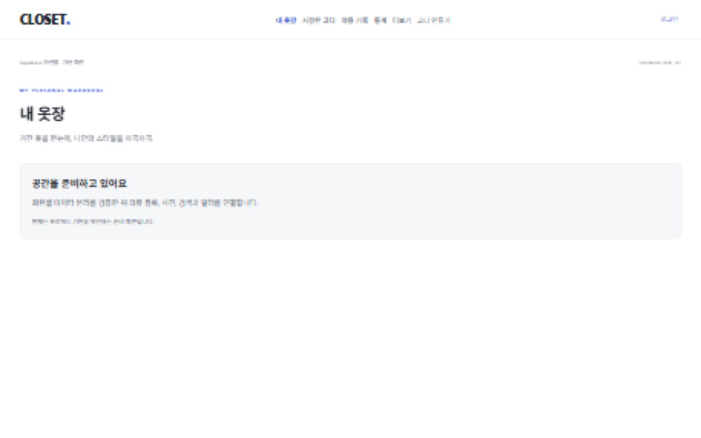
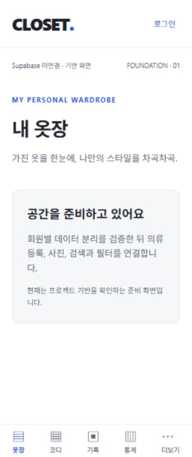

# 초기 기반 검증 결과

이 문서는 1단계 당시의 기록이다. 이후 DB 보안·인증 구현과 현재 검증 결과는 [PHASE_02_VALIDATION.md](PHASE_02_VALIDATION.md)를 참조한다.

검증일: 2026-10-28 (Asia/Seoul). 빈 폴더에 초기 프로젝트를 만들었고 원격 서비스 배포/제품 기능 개발은 수행하지 않았다.

## 결과

| 검증 | 결과 | 근거/범위 |
| --- | --- | --- |
| 의존성 설치 | PASS | npm install 성공, package-lock.json 보존 |
| TypeScript strict | PASS | `npm run typecheck`, 오류 0 |
| ESLint | PASS | `npm run lint`, 오류/경고 0 |
| 기반 단위 테스트 | PASS | `npm test`: 4개 파일, 16개 테스트 |
| Expo 호환성 | PASS | `npx expo install --check`: up to date |
| Expo Doctor | PASS | 20/20 checks |
| Web production export | PASS | `npm run export:web`, dist/index.html 및 번들 생성 |
| Android/iOS JS export | PASS | `npm run export:native -- --output-dir dist/native`, 양 플랫폼 Hermes 번들 생성 |
| Web smoke | PASS | 실제 브라우저에서 7개 주요 화면 이동, 루트 redirect, 로그인 직접 URL 새로고침, 테마 전환 확인 |
| 반응형 셸 | PASS | 아래 네 너비에서 document 및 내부 요소 가로 넘침 0 |
| 네이티브 실기기/emulator | NOT RUN | adb/emulator 없음, Windows에 Xcode 없음. 번들 성공은 실기기 성공의 대체가 아님 |
| Supabase SQL 실행/RLS/Storage 통합 | NOT RUN | Docker engine 미실행, 연결된 원격 프로젝트/키 없음. `supabase status`가 Docker 연결 실패 반환 |
| UI 레퍼런스 설계 대조 | PASS | 후속 수신한 원본 3장을 검토해 UI_REFERENCE_REVIEW.md 작성. 실제 제품 화면 일치 검증은 아직 미실행 |
| 의존성 보안 감사 | WARN | npm audit: 8건 (high 3, low 5), 아래 참조 |

테스트는 공개 환경값과 잘못된/서버용 키 거부, 개발용 HTTP 제한, 회원별 Query key, 진행 중 요청 취소와 query/mutation 캐시 제거, 네이티브 세션 저장의 큰 Unicode payload/실패 복구/손상 처리, 그리드 경계값을 검증한다. 실제 SecureStore 기기 암호화나 Auth 서버 동작을 검증한 테스트는 아니다.

| 너비(px) | document scrollWidth | 내부 가로 넘침 | 탐색 링크 수 |
| --- | --- | --- | --- |
| 320 | 320 | 0 | 하단 5 |
| 390 | 390 | 0 | 하단 5 |
| 1280 | 1280 | 0 | 상단 6 |
| 1440 | 1440 | 0 | 상단 6 |

가로 넘침 측정은 옷장 준비 화면 기준이다. 설정은 320/390px에서 줄바꿈과 스크롤을 확인했고 테마 선택의 aria-checked 변경도 확인했다. 제품 카드/그리드 자체는 아직 구현하지 않았으므로 실제 150개 목록 성능은 검증 범위가 아니다.

## 발견 후 수정

- AppState의 nullable 타입과 effect 초기 상태 처리에 대한 TypeScript/React lint 오류 수정.
- RN Web에서 테마의 accessibilityState가 DOM checked 속성으로 출력되지 않는 것을 발견해 명시적인 aria-checked 및 radiogroup 추가.
- Vitest config를 `.mts`로 변경해 CommonJS 경고를 제거하고 TypeScript 검사 범위에 포함.
- 최종 코드에서 `npm run check`와 웹/네이티브 export를 다시 통과했다.

브라우저 앱 오류는 발견되지 않았다. 검증 도중 서버 재시작에 따른 Metro disconnect 경고 1건은 기록됐고 재연결/새로고침 후 정상 동작했다.

## 남은 의존성 경고

현재 직접 사용하는 Zod는 4.6.7이다. Expo 58.0.20의 CLI는 Zod 3.25.76, config는 deepmerge 4.3.1을 전이 의존한다. npm audit는 두 의존성의 권고와 이를 사용하는 상위 패키지까지 합산해 8건을 보고한다.

- [Zod: 큰 collection 검증 시 메모리 소모](https://github.com/advisories/GHSA-mrhx-c7xc-m3w5)
- [deepmerge: prototype poisoning](https://github.com/advisories/GHSA-gcqx-w48m-w2h4)

audit의 제안은 Expo 51로 major downgrade하므로 적용하지 않았다. Zod 3을 강제로 4로 override하면 Expo CLI의 API 호환을 보장할 수 없다. 호환 패치 제공 여부를 추적하고 외부 공개 전 재감사한다. 현재 이 결과로 보안 검증 완료를 주장하지 않는다.

## 산출물과 다음 단계

- 첨부 문서 3개는 SHA-256 비교로 원본과 복사본이 동일함을 확인했다.
- 실제 환경값/키를 작성하지 않았다. `.env.local`, `.env.production`, signing key 파일과 빌드 결과의 Git ignore 동작을 확인했다.
- Git 저장소를 초기화했으며 커밋/원격 push는 하지 않았다.
- 설계: ARCHITECTURE / SECURITY / TASKS / ENVIRONMENT / DECISIONS.
- 후속 UI 레퍼런스: 원본 WebP 3장 보관, PRD/기반 코드와의 차이 및 컴포넌트 계약 문서화. 이 추가 작업은 문서/참조 파일 변경뿐이며 앱 소스·의존성 변경이나 테스트 재실행은 하지 않았다.
- 다음: A01 SQL 보완 및 로컬 DB 검증 → A02 2계정 보안 테스트 → A03 이메일 인증.

웹 준비 화면:

