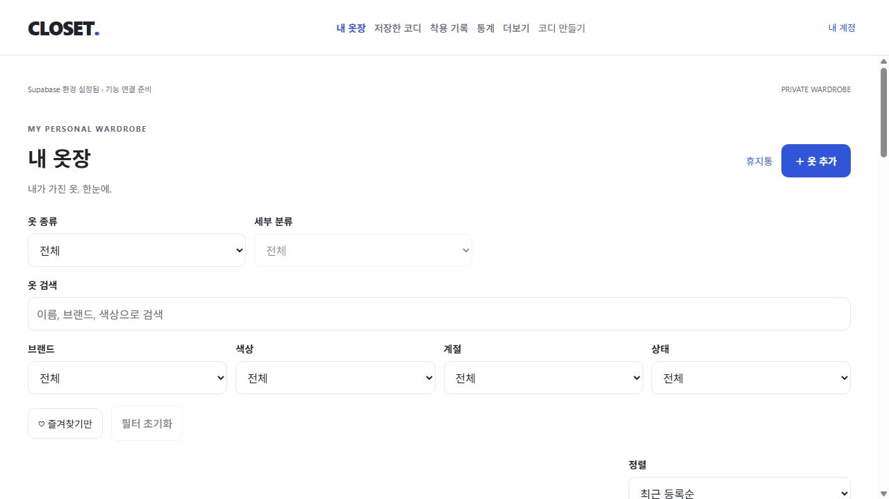

# 로컬 웹 지연 점검 — 2026-10-28

## 확인 결과와 조치

오래 실행된 Expo/Metro 개발 서버의 응답에서 큰 지연을 확인했다. 앱 소스나 DB 설정을 변경하지 않고 해당 서버 프로세스만 재시작한 뒤 응답이 회복됐다. 현재는 변경 감지와 자동 새로고침을 켠 일반 개발 모드다. 백그라운드 서버의 표준 출력/오류는 `test-results/expo-web.stdout.log`, `test-results/expo-web.stderr.log`에 기록한다.

| 측정 대상 | 재시작 전 | 재시작 후, 일반 개발 모드 |
| --- | --- | --- |
| HTML 전체 응답 | 약 1.4~1.8초 | 14~36ms |
| 개발 JavaScript 전체 응답, 동일한 6,700,561 bytes | 23,582~23,825ms | 최초 764ms, 반복 139~153ms |
| 로그인 후 주요 메뉴 6곳 → 제목 표시 | 당시 인증 상태로 측정하지 않음 | 107~394ms |
| 코디 편집 새로고침 → 후보 목록 표시 | 측정하지 않음 | 374ms |
| 본인 의류 첫 20개 DB 조회, 5회 | 측정하지 않음 | 14~29ms |

서버 응답은 같은 PC에서 Node fetch로 측정했다. 압축 전 JavaScript 크기이며, 다운로드 시간은 압축 해제까지 포함한다. 메뉴 측정은 IAB의 클릭 시작부터 제목 표시 대기까지로 도구 통신 시간이 포함된다. 전체 이미지 디코딩/렌더 완료나 실기기 측정값은 아니다. 임시 의류 30개와 사진이 있는 별도 테스트 계정을 사용했다. 첫 컴파일, 브라우저 캐시와 PC 부하에 따라 결과는 달라진다.

확인된 것은 기존 서버가 병목이었고 재시작으로 회복됐다는 점이다. 기존 프로세스 내부에서 지연이 시작된 정확한 원인(콘솔 출력, 변경 감지, 내부 상태 등)은 확정하지 않았다. 개발 모드의 큰 번들은 첫 접속 비용을 늘리지만, 같은 크기의 번들이 재시작 후 빠르게 전달됐으므로 크기만으로 기존 24초 지연을 설명할 수 없다. 캐시 유효 기간이나 회원 격리 정책은 변경하지 않았다.

정리 후 마지막 3회 재측정에서도 HTML 17~35ms, JavaScript 144~154ms였다. 대기 중 서버의 2초 CPU 증가량은 0초였다. 타입 검사와 측정 스크립트 문법/ESLint 검사가 통과했다. 테스트 계정은 로그아웃하고 이번 fixture의 계정·의류·사진만 정리했다. 사용자 계정이나 데이터는 변경하지 않았다.



## 다시 느려질 때

개발 서버가 켜진 상태에서 별도 PowerShell에서 실행한다.

```powershell
npm run web:measure
```

`http://127.0.0.1:8081/login`과 해당 HTML의 동일 서버 script를 각각 3회 읽는다. 로그인·DB 쓰기·비밀 키 조회 없이 HTML/JavaScript 응답 시간과 크기만 출력한다. 이 값은 브라우저 메뉴 전환 시간과 다르다.

서버 응답부터 수 초 이상 지연되면 실행 중인 **CLOSET 서버 터미널**에서 `Ctrl+C`로 종료한 뒤 `npm run web -- --port 8081`로 재시작한다. 백그라운드로 실행한 서버라면 8081 listener와 명령줄이 이 프로젝트인지 확인한 후 해당 프로세스만 종료해야 한다. 다른 Node 프로세스를 일괄 종료하지 않는다. 브라우저에서 새로고침 후 다시 측정한다.

서버 응답은 빠른데 메뉴가 느리면 해당 브라우저/계정의 재현 경로를 기준으로 데이터 요청·렌더링을 추가 점검한다. 앱 내 전환은 전체 번들을 매번 다시 받는 구조가 아니다. 운영 성능은 HTTPS Supabase를 연결한 production export로 별도 검증해야 한다.

Expo 개발/운영 모드의 차이: [공식 문서](https://docs.expo.dev/workflow/development-mode/).

## UI 작업 중 재발 원인 확인과 보완

최초 재시작만으로는 재발을 막지 못했다. UI 작업에서 export/테스트를 반복한 뒤 일반 개발 모드의 JavaScript 응답이 8.8초까지 늘고, 대기 중에도 서버가 CPU 한 코어를 거의 계속 사용했다.

서버의 5초 CPU profile에서 `@expo/metro-file-map@58.0.5`의 `FallbackWatcher.#unregisterDir`가 2,543 samples, `#processChange`가 404 samples로 최상위였다. debugger로 확인한 이벤트에는 Windows namespace 경로가 포함되어 있었다. 이를 감시 디렉터리에 다시 join하면서 존재하지 않는 중복 경로가 만들어졌고, 실제 감시 핸들을 닫지 못했다. 경로만 정규화하면 이미 존재하는 감시 루트를 반복 재탐색하는 경우도 있어 함께 차단했다.

- `metro.config.js`: 기존 Expo 제외 규칙을 보존하며 dist/test-results/coverage/Git/로컬 Supabase 임시 폴더/Vitest 캐시를 제외한다. 앱 소스와 일반 의존성은 계속 감시한다. [Metro blockList 문서](https://metrobundler.dev/docs/configuration/#blocklist).
- `scripts/patch-metro-watcher.cjs`: Windows 설치에서만 해당 **58.0.5 버전**의 이벤트 경로를 정규화한다. 존재하는 감시 루트 자체의 통지는 재탐색하지 않으며, 삭제된 루트는 올바른 경로로 정리한다. 외부 디렉터리/다른 드라이브 이벤트는 무시하고 원래 상대 파일 이벤트는 유지한다.
- `postinstall`로 적용하며 반복 실행은 멱등이다. 다른 Metro 버전에서는 검토를 요구한다. 상위 버전에서 해결되면 이 보완을 제거/갱신해야 한다. 앱 런타임/회원 보안 정책은 변경하지 않는다.
- `tests/metro-watcher.test.ts`: 감시 루트 자신/하위 파일/일반 파일/UNC/외부 경로를 검사한다. 새 테스트 3개 통과.

보완 후 일반 watch 모드에서 export와 검사를 다시 실행한 뒤 JavaScript 전체 응답은 175~183ms였다. 코디 검색 placeholder 수정이 새로고침 없이 반영되어 HMR을 확인했다. 장기간/다른 Windows 환경의 성능까지 보장하는 수치는 아니다. inspector는 진단 서버 종료와 함께 닫았다.

마지막 웹/Android/iOS export와 fixture 정리 후 재측정 3회는 HTML 7~39ms, JavaScript 144~148ms였고, 2초 대기 중 서버 CPU 증가량은 0초였다. 자동 변경 감지는 켜져 있다.

검증용 빈 `node_modules/.closet-watcher-check` 폴더는 셸 삭제 작업이 자동 검토에서 차단되어 남아 있다. 내용은 없으며 앱/배포 산출물에는 포함하지 않는다. 실제 검증은 정상 export, 경로 회귀 테스트, HMR 및 응답 재측정으로 완료했다.
